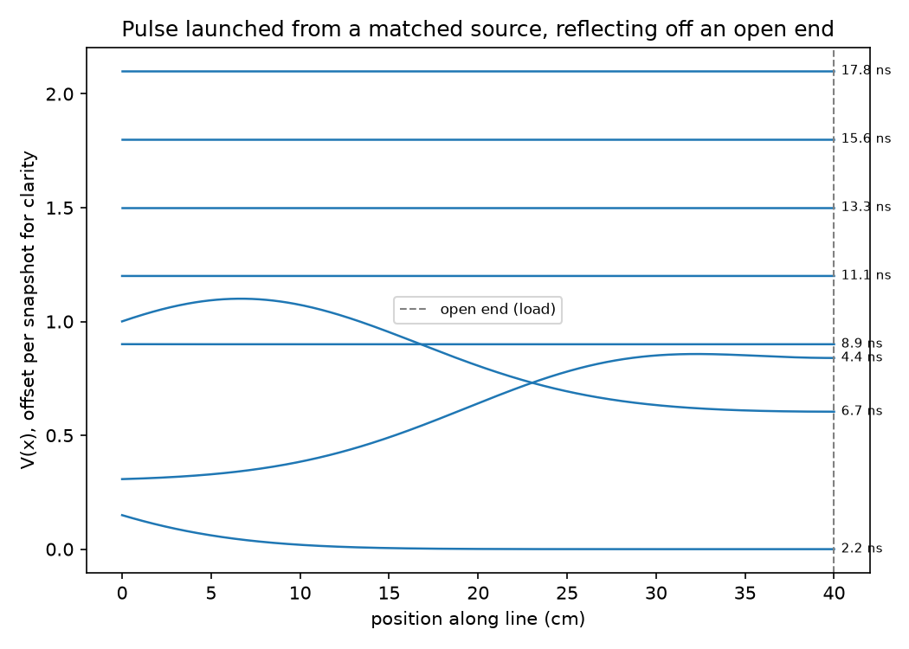
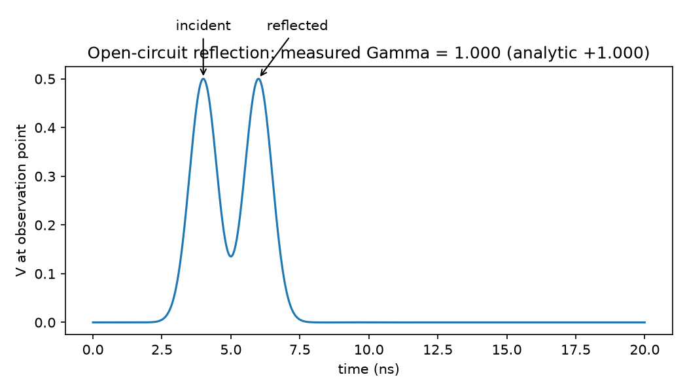
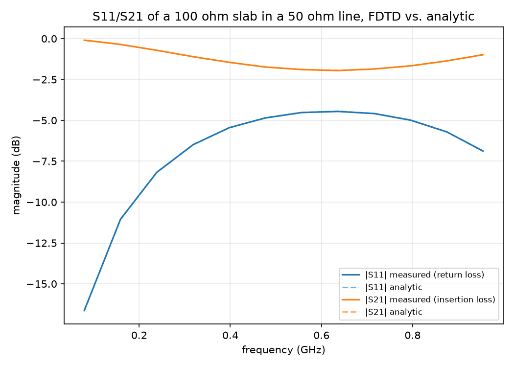
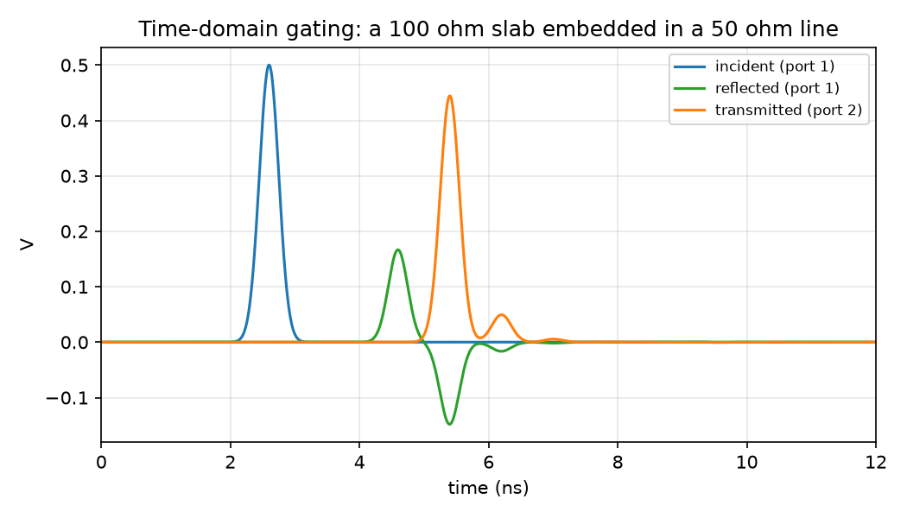
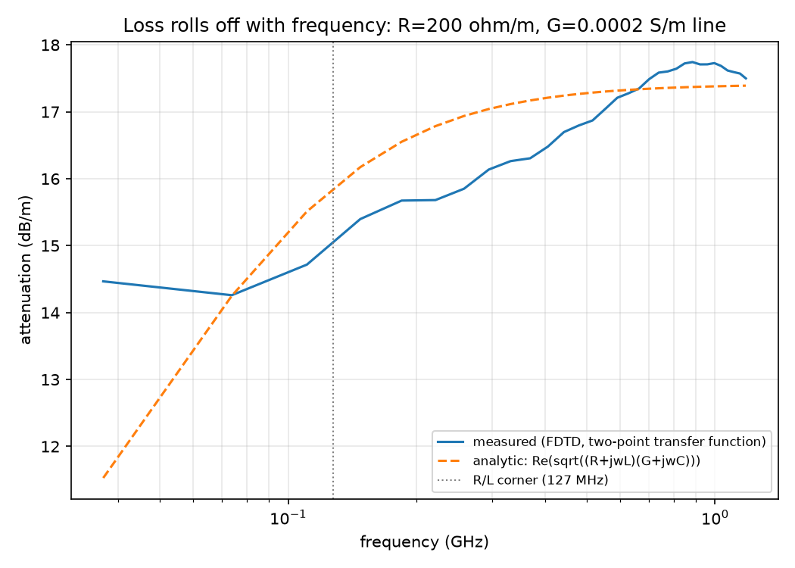
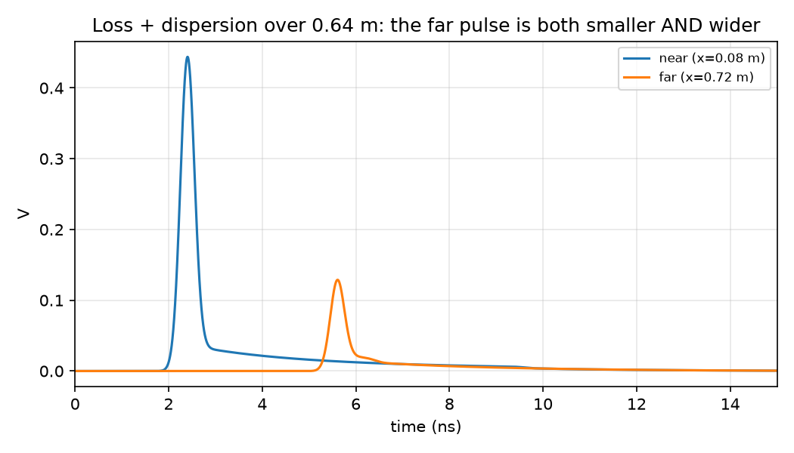

# fdtd-channel

A field solver I wrote from scratch to watch a signal travel down a circuit-board trace, bounce off what it hits, and fade with distance, with every result checked against the textbook formula. [Portfolio page](https://jackpham-rgb.github.io/jack-portfolio/)



## Goal and specs

In my [serdes-link](https://github.com/jackpham-rgb/serdes-link) project, the trace between the chips was a file of numbers I loaded and trusted. I wanted to see where those numbers come from, so I built the trace itself as a simulation.

A trace that carries fast signals behaves less like a wire and more like a pipe that waves travel down. I learned this is called a transmission line, and the two equations that describe it are called the telegrapher's equations. The way to solve them on a computer is to chop the line into small pieces and step forward in time. That method is called FDTD, finite-difference time-domain, so that is what I call the solver.

| Check | Target | Result |
|---|---|---|
| Reflection off a load | matches the analytic formula | within 0.0003 for 4 of 5 loads |
| Reflection and transmission vs frequency | matches the analytic two-port | worst error 0.0012 (reflection), 0.0016 (transmission) |
| Loss vs frequency | matches the analytic loss | within about 5 to 7% from 110 MHz to 1 GHz |
| Tests | all pass | `pytest tests/` |

## How it works

The time-stepping core is C++17. Python builds it, runs it, and does the analysis and plots.

The core stores voltage at grid points and current halfway between them, and updates them in turn. That staggered layout is called a Yee grid. It is what keeps the scheme accurate with a simple update.

It answers three questions, each with its own solver:

1. **Reflection.** When a wave hits the end of a line, part of it comes back. The fraction that comes back is called the reflection coefficient. I measure it from the simulated waveform and compare it to the formula Γ = (ZL − Z0) / (ZL + Z0).
2. **S-parameters.** A lab instrument called a network analyzer sends a signal into a part and records how much comes back and how much gets through, at every frequency. Those two curves are called S11 and S21, or S-parameters. I put a short section of different impedance in the middle of the line and pull S11 and S21 out of the fields, which turns the simulation into a virtual network analyzer.
3. **Loss.** I added resistance along the wire and leakage through the board material. With those, the line loses more at high frequency than at low, which is why fast signals fade.

Three decisions mattered most:

- **A source that absorbs.** The source has the same resistance as the line, so anything that comes back is absorbed instead of bouncing out again. Without it every reflection measurement was wrong.
- **Separate the waves by timing.** I run each case twice, once with the discontinuity and once without, and subtract. Before a reflection can physically arrive, the two runs are identical, so the difference is exactly the reflected wave. Real network analyzers do something similar, called time-domain gating.
- **Treat the loss half-implicitly.** Adding resistance the simple way gives the scheme a new, tighter stability limit. Averaging the loss term between the old and new value keeps the original limit.

## Results



| Load | Measured Γ | Formula Γ |
|---|---|---|
| matched, 50 Ω | 0.0114 | 0.0000 |
| open | 1.0000 | 1.0000 |
| short | −1.0000 | −1.0000 |
| 25 Ω | −0.3330 | −0.3333 |
| 100 Ω | 0.3336 | 0.3333 |

The matched case has the largest error because its true answer is zero, so small grid noise is all that is left.



A 100 Ω section in a 50 Ω line. The dashed formula curves sit almost exactly under the measured ones.



The reflected wave has two lobes: one off the first edge of the section, and one after a full trip inside it. Those two interfering is what makes S11 and S21 change with frequency.





The pulse comes out both smaller and wider. Getting smaller is called attenuation. Getting wider is called dispersion: different frequencies in the pulse travel and fade differently.

Full write-ups: [reflection](docs/01-telegrapher.md), [S-parameters](docs/02-sparameters.md), [loss](docs/03-loss.md).

## What broke and how I fixed it

- **The source kept adding energy.** I added the pulse to the first node every step, so a smaller time step meant more energy, and the run blew up faster. Making the source a physical quantity independent of the time step fixed it.
- **The source re-reflected everything.** A perfect voltage source bounces back whatever reaches it, so every load measured nearly the same wrong value. The matched source above fixed it.
- **A window with no flat top.** I used a Hamming window before the Fourier transform. It weights each pulse differently depending on when it arrives, which threw S21 off by 20 to 50%. A Tukey window, flat in the middle, brought the error under 2%. A test keeps this from coming back.

## Reproduce it

Python 3.10 or newer, and g++ with C++17 on the path.

```bash
python -m venv .venv && source .venv/bin/activate   # .venv\Scripts\activate on Windows
pip install numpy scipy matplotlib pytest
python py/run_telegrapher.py   # reflection figures and table
python py/run_sparams.py       # S-parameter figures
python py/run_loss.py          # loss figures
pytest tests/ -v
```

Each script compiles its C++ core automatically.

## Repo layout

```
src/     C++ time-stepping cores, one per solver
py/      builds and runs the cores, analysis and plots
tests/   pytest checks against the analytic formulas
docs/    write-ups and figures
```

## Limits and next revision

- This is a teaching-grade solver, not a replacement for commercial tools like HFSS or ADS.
- Resistance is constant with frequency. Real copper loss grows with the square root of frequency, called the skin effect. Modeling that is the next step.
- Below about 100 MHz the measured loss flattens too early, because the simulated time window is too short for those slow frequencies. Results there are left out of the claims.
- The line is one-dimensional.
